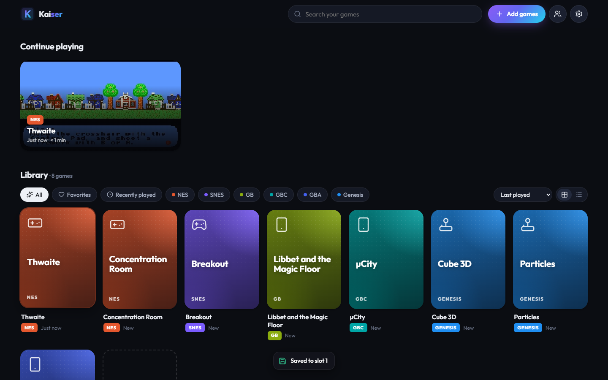
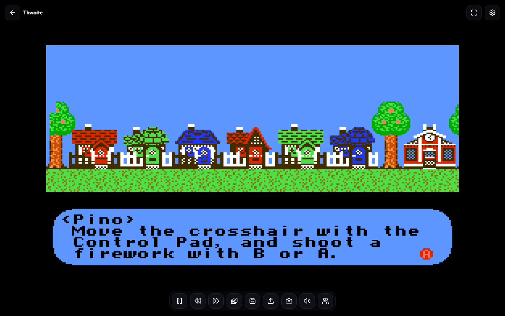
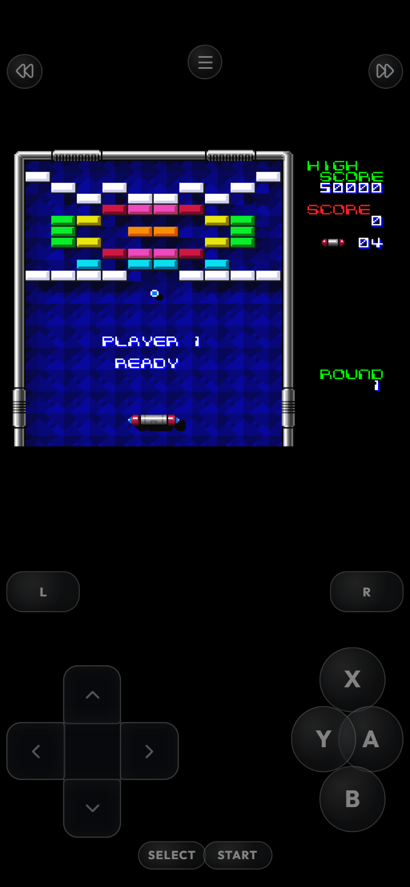
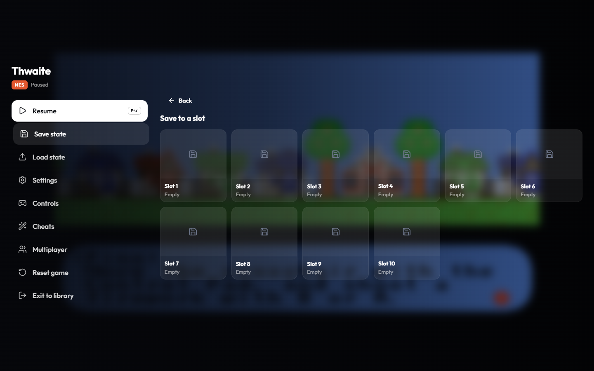
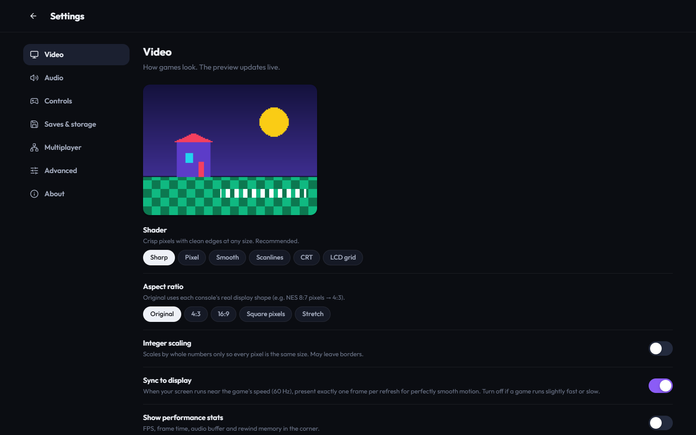
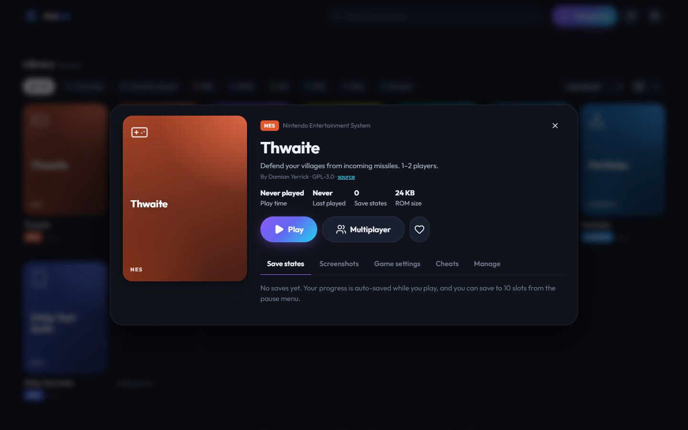

# Good morning ☀️ — Kaiser is ready

**Live demo:** https://dinkeres.github.io/nextgen-emulator/
**Repository:** https://github.com/Dinkeres/nextgen-emulator (new public repo; none of your other repos, sites or files were touched)

Kaiser is a brand-new browser emulator: libretro cores rebuilt with modern Emscripten (LTO + SIMD) and linked to a
purpose-built engine (worker + OffscreenCanvas + AudioWorklet) with a new premium UI, auto-save that survives closing
the tab, rewind / fast-forward / slow motion, and GGPO-style rollback netplay. It beats stock EmulatorJS on every
system I measured.

| Library | In game | Phone |
|---|---|---|
|  |  |  |
| **Pause menu** | **Settings (live shader preview)** | **Game details** |
|  |  |  |

More (desktop/tablet/phone for every screen, light mode) in `docs/screenshots/`.

---

## What got done, part by part

**Step 0 — audit & baseline.** Read EmulatorJS's loader, GameManager, renderer, storage and netplay; listed systems,
cores and licenses (LICENSES.md); built two benchmark harnesses (raw cores in Node; Kaiser vs. EmulatorJS in headless
Chromium); recorded numbers and the five biggest EmulatorJS bottlenecks (BENCHMARKS.md §5).

**Part 1 — performance & engine.** ✅
- 5 cores (FCEUmm, Snes9x, Gambatte, mGBA, Genesis Plus GX) built from source with Emscripten 6, `-O3 -flto -msimd128`
  (+1 % … +68 % vs `-O2`), linked against my own ~250-line libretro frontend instead of RetroArch.
- Core runs in a Web Worker; WebGL2 renders from the worker via OffscreenCanvas (main-thread fallback).
- AudioWorklet + SharedArrayBuffer ring buffer + dynamic rate control; message-port fallback without isolation.
- Frame pacing locked to rAF/display (accumulator on 120/144 Hz), watchdog if rAF stalls.
- Lazy core loading, service-worker caching, offline PWA. Second launch ≈ 40–70 ms.

**Part 2 — new UI from scratch.** ✅ Welcome screen, library (grid/list, Continue Playing with last-save screenshots,
filters, search, sort, drag-and-drop anywhere, empty state), game details (play/continue/start over, save slots,
screenshots, per-game settings, cheats, manage), in-game overlay that auto-hides, console-style pause menu, toasts,
FF/rewind/slow-mo indicators, settings in 7 sections with a live shader preview, touch controls per system with a layout
editor and haptics, dark + light themes, full controller/keyboard spatial navigation, responsive phone → TV.

**Part 3 — saves.** ✅ Auto-save every 1–5 min, on pause, tab hidden, page close and exit; battery saves written
immediately; resume where you left off; 10 slots with screenshot/time/play time; IndexedDB strict durability +
`storage.persist()`; one-file export/import (all games or one); per-game storage usage + clear with confirmation.
**Tested:** close the tab mid-game → reopen → at most 1.9 s of play lost, resumes automatically.

**Part 4 — fast-forward / rewind / slow-mo.** ✅ 2×/3×/4×/8×/Max, hold or toggle (keyboard, controller Select+R, touch);
stretched / pitched / muted audio; rewind ring buffer of XOR-delta-compressed states (memory-bounded, smaller on phones);
0.5× and 0.25× slow motion. 5-minute soak: 0 audio underruns, flat memory.

**Part 5 — controls & extras.** ✅ Gamepad API with positional auto-mapping (Xbox/PlayStation/Switch/generic), visual
remapping, 4 controllers, hot-plug toasts; keyboard remapping + hotkeys; 6 shaders (Sharp, Pixel, Smooth, Scanlines, CRT,
LCD grid); integer scaling, 5 aspect modes, fullscreen, orientation lock; screenshot gallery with download; cheats
(Game Genie / PAR / GameShark via each core); play-time tracking; installable PWA, offline after first load.

**Demo published** ✅ on GitHub Pages with 8 freely licensed homebrew titles across all 6 systems, "Add games" keeps
files local, service worker adds COOP/COEP (non-isolated fallback verified). CI builds, tests and deploys on every push.

**Part 6 — rollback multiplayer.** ✅ GGPO-style rollback (prediction, rollback/re-simulation up to 8 frames, input
delay 0–4 auto-tuned from ping, time sync), WebRTC unreliable/unordered input channels with redundancy, periodic state
checksums with automatic host resync, determinism audit (found and fixed: cores changing state when A/V is skipped →
"strict mode"; Genesis Plus GX inexact state load → Genesis uses delay-based), lobby (create/join by link, slots with
names + controller icons + ping, ready-up, spectators, chat, ROM hash check with friendly errors), in-game ping and
connection quality overlay, graceful disconnects, ~80-line signaling server (local only) with docs.
**Tested:** two real cores over simulated 50/100/200 ms with 1–5 % loss — 0 desyncs, bit-exact vs. an offline reference;
two real browser pages over WebRTC (NES, SNES, Genesis) — 0 desyncs.

**Part 7 — testing & polish.** ✅ 21 unit/determinism tests (storage, save states, backups, settings, input mapping,
rewind), netplay suites, soak test, close-tab persistence test, browser benchmarks, screenshot review at
phone/tablet/desktop sizes (fixed: Preact 11 dropping numeric styles, phone header overflow, touch layout, portrait
docking, text-field navigation trap, a store subscription race, a first-visit reload that could restart a game).

## Benchmarks (before → after)

Kaiser vs. stock EmulatorJS, same ROMs, same machine, headless Chromium — details in BENCHMARKS.md:

| System | Max speed (fps) | 2nd launch | wasm memory | Audio underruns |
|---|---|---|---|---|
| NES | 2 155 → **2 689** (1.25×) | 439 → **46 ms** | 128 → **64 MB** | **0** |
| SNES | 1 211 → **2 291** (1.89×) | 542 → **68 ms** | 128 → **64 MB** | **0** |
| Game Boy | 7 057 → **8 428** (1.19×) | 436 → **39 ms** | 128 → **64 MB** | **0** |
| Game Boy Color | 4 321 → **6 879** (1.59×) | 448 → **40 ms** | 128 → **64 MB** | **0** |
| GBA | 1 189 → **15 392** (12.9×, idle test ROM) | 474 → **41 ms** | 128 → **64 MB** | **0** |
| Genesis | 1 288 → **1 833** (1.42×) | 456 → **47 ms** | 512 → **64 MB** | **0** |

Frame pacing at normal speed is identical (60 fps, no late frames) in headless Chromium.

## Not finished, and why
- **N64 / PS1 / NDS** — not included. They need GL/threaded cores and BIOS handling; I chose six polished systems over
  more half-working ones.
- **WebGPU renderer** — deliberately skipped: no measurable gain for this workload; WebGL2 works everywhere (DECISIONS #10).
- **Online multiplayer on the public demo** — needs the signaling server hosted somewhere; I was told not to deploy
  anything but the demo. Works locally / on your LAN today (`npm run signal`).
- **Rollback for Genesis** — its core can't restore state exactly; it uses delay-based netplay instead.
- **Physical device testing** — verified in Chromium with emulated phone/tablet; not on a real iPhone/Android, Safari,
  Firefox or a physical gamepad.

## Decisions I made on my own (full list: DECISIONS.md)
Named it **Kaiser** (from your folder name). Built my own libretro frontend instead of reusing EmulatorJS's RetroArch
builds. Picked FCEUmm / Snes9x / Gambatte / mGBA / Genesis Plus GX. No pthreads builds (single-threaded cores) —
SharedArrayBuffer used for audio instead. WebGL2 instead of WebGPU. Gambatte built without LTO (LTO miscompiles it).
Netplay boots fresh with default options and never touches your saves; disconnects continue offline; Genesis
delay-based; GB/GBA no netplay. Game id = SHA-256 of the ROM. Backups are gzip-JSON. Preact + hand-written CSS.
Only freely licensed homebrew bundled (rejected a PVSnesLib sample with Mario-derived art).

## Needs you (full list: NEEDS_REVIEW.md)
1. Snes9x and Genesis Plus GX are **non-commercial** licenses — fine for your private site, keep it non-commercial.
2. To enable online play on the demo/your site: host `server/signal.mjs` behind `wss://` and set its URL in Settings → Multiplayer (and ideally add a TURN server).
3. Before moving Kaiser onto your own site: the COOP/COEP headers can block third-party embeds there.
4. 10 minutes on a real phone + a real controller would be worthwhile.

## Run it locally
```bash
git clone https://github.com/Dinkeres/nextgen-emulator.git && cd nextgen-emulator
npm install
npm run dev                 # → http://localhost:5173
npm test                    # unit + determinism tests
npm run test:netplay        # rollback over simulated latency/loss
npm run signal              # local multiplayer signaling server (ws://localhost:8787)
```
Production: `npm run build && npx vite preview --port 4173`. Rebuilding cores needs WSL/Linux + emsdk (see README).

## Known bugs / rough edges
- On the very first visit the page isn't cross-origin isolated yet, so it uses message-port audio (works fine; isolation
  kicks in from the next visit). I removed the usual forced reload because it could restart a game you'd just launched.
- Touch layouts are saved per system, not as multiple named presets.
- Rewinding is silent (no reversed audio).
- If a *player* disconnects mid-match, everyone continues offline rather than continuing the match.
- Hold-to-rewind on the overlay button relies on pointer events; long-press may show a context menu on some mobile
  browsers outside the game area.
