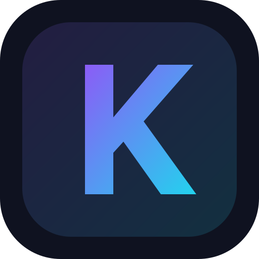
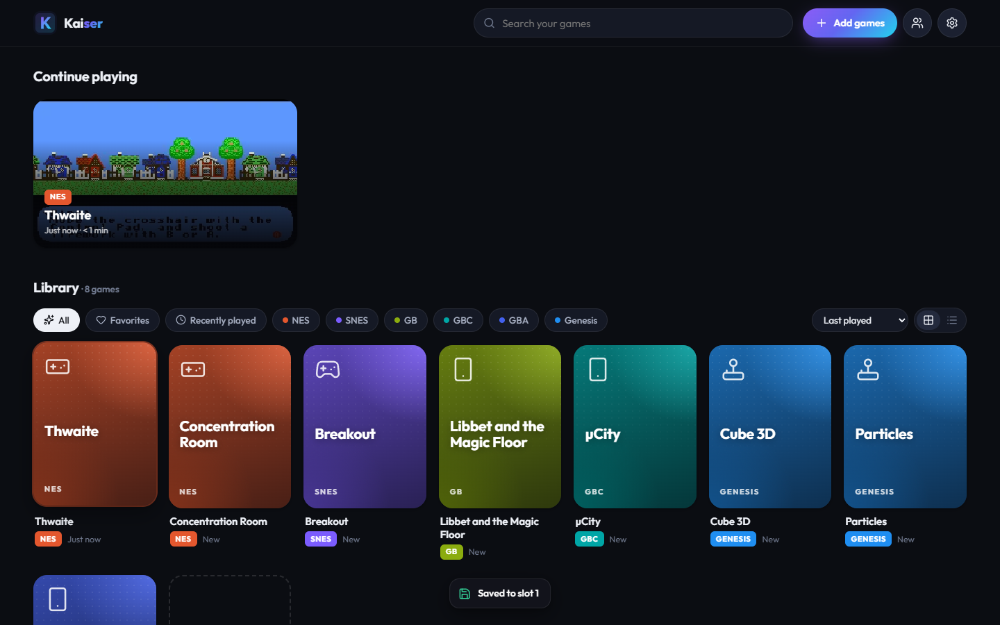
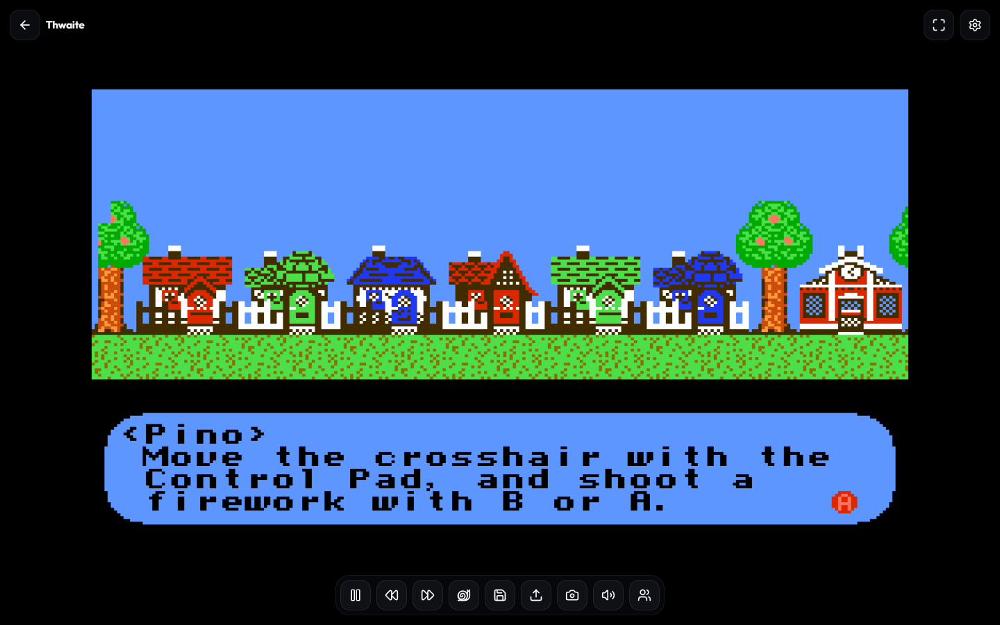
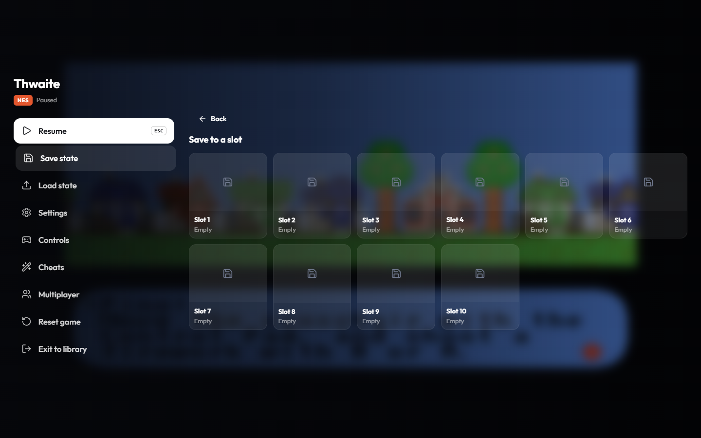
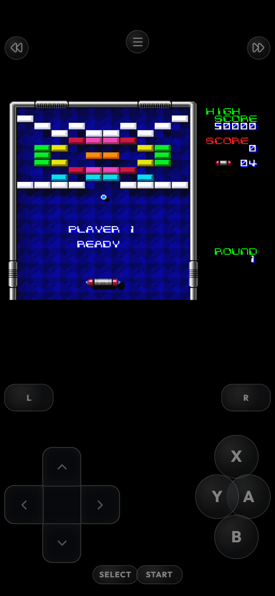

<p align="center"></p>

<h1 align="center">Kaiser</h1>
<p align="center"><b>A next-generation emulator for the browser.</b><br>
Fast, smooth, never loses your progress — with rewind, fast-forward, auto-save and rollback netplay.</p>

<p align="center"><a href="https://dinkeres.github.io/nextgen-emulator/"><b>▶ Try the demo</b></a> · <a href="BENCHMARKS.md">Benchmarks</a> · <a href="DECISIONS.md">Design decisions</a> · <a href="LICENSES.md">Licenses</a></p>



| In game | Pause menu | Phone |
|---|---|---|
|  |  |  |

## Features

**Engine**
- libretro cores (FCEUmm, Snes9x, Gambatte, mGBA, Genesis Plus GX) compiled with modern Emscripten, `-O3`, LTO and WebAssembly SIMD, linked to a tiny purpose-built frontend instead of all of RetroArch.
- Emulation runs in a **Web Worker** and renders with **WebGL2 on an OffscreenCanvas** — the UI can never stall the game.
- **AudioWorklet** with a lock-free shared ring buffer and dynamic rate control: no crackle, no drift.
- Frame pacing locked to your display at 60 Hz, accumulator-based on 120/144 Hz screens.
- Cores load on demand, are cached by a service worker, and start in ~50 ms on the second launch. Works offline as a PWA.

**Play**
- **Fast-forward** 2×/3×/4×/8×/Max (hold or toggle; muted, pitched or time-stretched audio) · **Rewind** (hold) · **Slow motion** 0.5×/0.25×.
- **Never lose progress**: auto-save every 1–5 min, on pause, when the tab is hidden and when the page closes; battery saves written immediately; "resume where you left off"; 10 save slots with screenshots; one-file backup/restore.
- Shaders: Sharp pixels, Pixel, Smooth, Scanlines, CRT, LCD grid — with a live preview. Integer scaling, aspect-ratio options, fullscreen, orientation lock.
- Controllers auto-mapped by button position (Xbox, PlayStation, Switch Pro, generic), hot-plugging, up to 4 players, full keyboard and controller remapping.
- Touch controls designed per system with a drag-and-resize layout editor and haptics.
- Screenshot gallery, cheat codes (Game Genie, Pro Action Replay, GameShark…), play-time tracking, favourites, search, filters.

**Multiplayer — rollback netcode**
- GGPO-style: every player runs the game locally and only inputs cross the network (WebRTC, unreliable/unordered).
- Remote inputs are predicted; late inputs trigger an invisible rollback and re-simulation (≤ 8 frames).
- Input delay auto-tuned from ping, periodic state checksums with automatic resync, spectators, lobby chat.
- ROMs are matched by SHA-256 and never transferred. NES and SNES use rollback; Genesis uses delay-based netplay.

**Interface**: designed to be driven entirely by controller (D-pad navigation everywhere), mouse, keyboard or touch. Dark and light themes.

## Kaiser vs. EmulatorJS

Same ROMs, same machine, headless Chromium ([full table and methodology](BENCHMARKS.md)):

| | EmulatorJS | Kaiser |
|---|---|---|
| Max speed (fast-forward ceiling), NES / SNES / Genesis | 2 155 / 1 211 / 1 288 fps | **2 689 / 2 291 / 1 833 fps** |
| Second launch to first frame | 440–540 ms | **40–70 ms** |
| WebAssembly memory | 128–512 MB | **64 MB** |
| Emulation thread | main thread | **worker** |
| Netplay | host streams video | **rollback, inputs only** |
| Audio underruns at normal speed | not measurable | **0** |

## Supported systems

| System | Core | Netplay |
|---|---|---|
| NES / Famicom | FCEUmm | Rollback, up to 4 players |
| Super Nintendo | Snes9x | Rollback, up to 4 players |
| Game Boy / Game Boy Color | Gambatte | — (single player) |
| Game Boy Advance | mGBA | — (single player) |
| Genesis / Mega Drive (also Master System, Game Gear) | Genesis Plus GX | Delay-based, up to 4 players |

## Run it locally

```bash
git clone https://github.com/Dinkeres/nextgen-emulator.git
cd nextgen-emulator
npm install
npm run dev              # http://localhost:5173 (sends COOP/COEP headers)
```

Production build: `npm run build && npx vite preview --port 4173`.

Multiplayer on your machine/LAN: `npm run signal` (signaling server on `ws://localhost:8787`), then open two tabs
→ Multiplayer → Create room / Join. See [server/README.md](server/README.md).

### Hosting it yourself
Serve `dist/` from any static host. For shared-memory audio, send these headers (otherwise the bundled service worker
adds them, and if that's impossible Kaiser falls back to message-based audio automatically):

```
Cross-Origin-Opener-Policy: same-origin
Cross-Origin-Embedder-Policy: require-corp
```
Serve `.wasm` as `application/wasm` so cores compile while downloading.

### Tests and benchmarks
```bash
npm test                 # unit tests (storage, saves, settings, input, rewind) + core determinism
npm run test:netplay     # two real cores over a simulated 50–200 ms network with packet loss
npm run bench            # raw core speed, state save/load cost (Node)
npm run bench:browser    # Kaiser vs EmulatorJS in headless Chromium (see BENCHMARKS.md for setup)
npm run screenshots      # every screen at desktop/tablet/phone sizes
```

### Rebuilding the cores
Needs Linux or WSL with Emscripten at `~/ngemu/emsdk`:
```bash
bash cores/fetch.sh && bash cores/build.sh            # all cores
bash cores/build.sh "snes9x"                           # one core
```

## Bundled games
Freely licensed homebrew so you can try it immediately: *Thwaite*, *Concentration Room*, *Libbet and the Magic Floor*,
*µCity*, *Breakout*, *Cube 3D*, *Particles* and the *240p Test Suite* — credits and licenses in [LICENSES.md](LICENSES.md).
Kaiser never downloads games; **Add games** keeps your files in your own browser.

## Credits & license
GPL-3.0-or-later. Built by studying [EmulatorJS](https://github.com/EmulatorJS/EmulatorJS) and using the libretro cores
by their respective authors — see [LICENSES.md](LICENSES.md). Snes9x and Genesis Plus GX are licensed for
non-commercial use only, so Kaiser must be used non-commercially.
